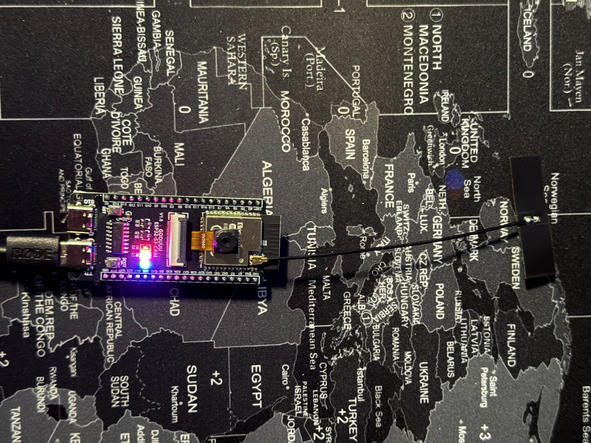
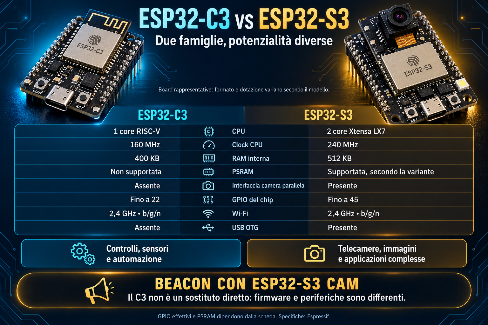

# ESP32-S3-CAM_PDX DATV Beacon

*English · [Italiano](README_it.md)*

A stand-alone **DVB-S2** amateur television beacon for the 13 cm band (2300–2450 MHz) — and, through an external mixer,
for any other band — built on a single **ESP32-S3 camera board**. The chip's Wi-Fi transmitter is driven as an I/Q
modulator, while video, MPEG-TS multiplexing, DVB-S2 coding (BCH, LDPC, PL framing) and RRC-shaped QPSK are all computed
on the ESP32-S3 itself. No SDR, PC or Raspberry Pi needed.


## Features

- **DVB-S2 QPSK**, symbol rate **125 / 250 / 333 / 500 / 1000 kS/s** (1000 kS with the test card only), FEC 1/2 to
  9/10, normal frames with pilots — received with **MER 23–27 dB** on Portsdown 4 and Minitiouner (MER 25 at 500 and
  1000 kS, v1.1.0). DVB-S2 encoder written from ETSI EN 302 307-1 and verified bit for bit (42/42 test cases).
- **2300–2450 MHz** directly; **IF output for an external mixer** (transverter): set the local oscillator and the final
  frequency is shown in the overlay and in the DVB service name; inverted spectrum is compensated.
- **Live camera** (H.264 320x240), camera **picture-in-picture** on the test card, standard H.265 test card, test card
  with **live data**, **custom test cards** (a photo from your phone or a video prepared on the PC) — Halloween one
  included.
- **Stand-alone beacon**: test card / camera / pause cycle, automatic start at power-on, output level in dB, RGB status
  LED whose colour "warms up" with the output level (normal, minimum or off for battery/solar operation).
- **Telemetry overlay** (optional): chip temperature, uptime and cycle number; temperature also on the web page and in
  the serial log at the end of every segment. **QTH locator** in the overlay and in the DVB service provider name.
- **Web set-up from your phone** in 11 languages (IT, EN, DE, ES, FR, PT, NL, PL, EL, JA, AR) while not transmitting;
  full serial command set.

## Install

- **From the browser, nothing to install:** https://photoluis.github.io/Esp32s3-cam-pdx-datv-beacon/ (Chrome / Edge)
- **Windows package** with `esptool.exe` and double-click scripts: `…_Windows.zip` on the
  [release page](https://github.com/Photoluis/Esp32s3-cam-pdx-datv-beacon/releases)
- Step-by-step guide (browser, Windows, Python, build from source): [docs/INSTALL.md](docs/INSTALL.md) ·
  [italiano](docs/INSTALL_it.md)

The firmware is built with ESP-IDF, not Arduino: no Arduino IDE is needed to install it.

## Documentation

- [Installation guide](docs/INSTALL.md)
- [The project](docs/PROGETTO.md) (Italian; [complete PDF](docs/ESP32-S3-CAM_PDX_DATV_Beacon.pdf), also offline)
- [Presentation in 11 languages](docs/presentazione/) with an invitation to collaborate (Markdown + PDF)
- [Custom test cards](docs/MONOSCOPIO.md) (Italian)
- [MER / linearity test](docs/TEST_MER_20261030.md), 30 Oct 2026 (Italian)

## Hardware

- ESP32-S3 N16R8 board (16 MB flash, 8 MB PSRAM) with OV3660 camera, USB-C and TTL serial, RGB LED on GPIO48
  (tested: diymore ESP32-S3-CAM, Freenove layout).
- 13 cm antenna. **A band-pass filter on the output is required for on-air use**: the DAC produces images.
- **RF output on the PCB antenna by default:** to use the IPEX connector (needed for the filter and for power
  measurements) a tiny 0402 part on the module must be moved — see [docs/ANTENNA_IPEX.md](docs/ANTENNA_IPEX.md).
- A DVB-S2 receiver (e.g. Minitiouner / Portsdown 4).



**Why the S3 and not the C3?** The ESP32-C3 has one RISC-V core, no PSRAM and no camera interface: it cannot run the
camera, the H.264 encoder and the DVB-S2 coder at the same time. The beacon needs the S3 (two cores, 8 MB PSRAM,
parallel camera port); firmware and peripherals are different, so the C3 is not a drop-in replacement.



## Build and flash

Firmware (ESP-IDF 6.1):
```
cd firmware
idf.py set-target esp32s3
idf.py -p COM3 flash
```
Standard test card and PiP background (PC: Python 3 with numpy and Pillow, ffmpeg with libx265):
```
cd tools
python make_es.py -o out/mono_es.bin
python make_bg.py -o out/bg_std.bin
python -m esptool --port COM3 write-flash 0x810000 out/mono_es.bin 0xC10000 out/bg_std.bin
```
Main serial commands (115200 baud): `INFO`, `CONFIG`, `SET <key> <value>`, `SAVE`, `BEACON`, `ESPLAY`, `MEDIA`,
`LEDTEST`; the full list is at the top of `firmware/main/main.c`. Web page: Wi-Fi network `<CALLSIGN>-BEACON`,
http://192.168.4.1.

## Contributing

On-air reports, bug reports, improvement requests and translation reviews are very welcome: open an *Issue* or a
*Discussion*, or write to **iz7pdx@gmail.com**.

## Legal notice

The board only transmits between 2300 and 2450 MHz. **Use it only with a valid amateur radio licence, on the
frequencies and at the power levels allowed by your licence and band plan**, always with a suitable filter on the
output (and after the mixer when using a transverter).

## Credits

- DVB-S2: ETSI EN 302 307-1 V1.4.1. LDPC tables extracted from the standard and verified (`tools/dvbs2/etsi_tables.py`).
- Espressif components: ESP-IDF, esp32-camera, esp_h264 (Apache 2.0; esp_h264 contains OpenH264, BSD).

## Licence

GPL-3.0 — see [LICENSE](LICENSE). © 2026 Luigi D'Arcangelo IZ7PDX — iz7pdx@gmail.com
