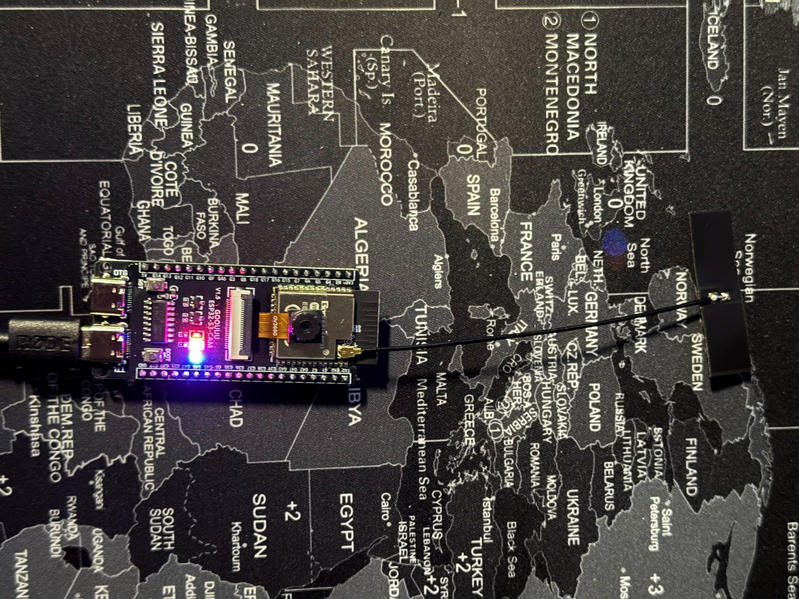

# Installation guide — ESP32-S3-CAM_PDX DATV Beacon

*[Italiano](INSTALL_it.md)*

Four ways to put the firmware on the board, from the easiest to the most complete. Methods 1–3 need **no
compiler, no Arduino IDE and no ESP-IDF**.

| # | Method | Needs | Best for |
|---|---|---|---|
| 1 | **Browser installer** (GitHub Pages) | Chrome or Edge on a computer | everybody |
| 2 | **Windows package** (`…_Windows.zip`) | Windows 10/11 | offline / Windows users |
| 3 | **Python + esptool** | Python 3 | Linux, macOS, scripting |
| 4 | **Build from source** | ESP-IDF 6.1 | developers |

> **Arduino?** The firmware is written for **ESP-IDF**, Espressif's official framework, not for Arduino: it drives the
> Wi-Fi radio at register level, uses custom memory placement for the real-time modulator and its own partition table.
> It cannot be opened as an Arduino sketch. To program the board without installing anything, use method 1 or 2:
> the result is the same firmware the author runs.



## Before you start

- Board: ESP32-S3 **N16R8** (16 MB flash, 8 MB PSRAM) with OV3660 camera. The tested board has two USB-C ports:
  **COM** (CH340 USB-serial chip) and **OTG** (native USB). Use **COM** for programming and for the serial console.
- A USB-C **data** cable (some cables only charge).
- The RF output usually leaves the factory on the **printed antenna**, not on the IPEX connector: see
  [ANTENNA_IPEX.md](ANTENNA_IPEX.md) before connecting a filter or measuring power.
- Windows: Device Manager → *Ports (COM & LPT)* must show `USB-SERIAL CH340 (COMx)`. If it does not, install the
  WCH **CH341SER** driver.
- If programming fails to connect, enter download mode by hand: hold **BOOT**, press and release **RST**, release
  **BOOT**, try again.

Images in the release:

| File | Write at | Content |
|---|---|---|
| `…_full.bin` | `0x0` | bootloader, partition table, firmware, standard test card, standard PiP background. **Erases settings and custom test cards.** |
| `…_app_0x10000.bin` (v1.2.0+) | **`0x10000`** | firmware only. **Keeps** settings and custom test cards. |

> **Note on v1.0.0 / v1.1.0:** their `…_app_only.bin`, written at `0x0`, also covers the settings area (`0x9000`) and
> therefore **erases the settings** (the custom test cards are kept). From v1.2.0 the update file contains only the
> firmware and is written at `0x10000`.

## 1. Browser installer

1. Open **https://photoluis.github.io/Esp32s3-cam-pdx-datv-beacon/** with Chrome or Edge (desktop).
2. Connect the board to the COM port, click **Install**, choose the port, confirm.
3. First installation: tick *Erase device*. Update: leave it unticked.
4. Press **RST** at the end and go to [First set-up](#first-set-up).

The page uses [ESP Web Tools](https://esphome.github.io/esp-web-tools/) and the browser's Web Serial API; nothing is
installed on the computer. Firefox and Safari do not support Web Serial.

## 2. Windows package

1. Download `ESP32-S3-CAM_PDX_DATV_Beacon_v1.2.0_Windows.zip` from the
   [release page](https://github.com/Photoluis/Esp32s3-cam-pdx-datv-beacon/releases) and unzip it.
2. Double-click:
   - `1_INSTALL_FULL_erase.bat` for the first installation;
   - `2_UPDATE_firmware_only.bat` to update and keep your settings.
3. Type the COM port (e.g. `COM3`) or just press Enter for automatic detection.

The package contains Espressif's `esptool.exe` (GPL-2.0), the two images and the scripts. Windows SmartScreen may ask
for confirmation the first time (*More info → Run anyway*).

## 3. Python + esptool

```
python -m pip install esptool
# first installation (erases settings and custom test cards)
python -m esptool --chip esp32s3 --port COM3 -b 460800 write-flash 0x0 ESP32-S3-CAM_PDX_DATV_Beacon_v1.2.0_full.bin
# update only (keeps settings)
python -m esptool --chip esp32s3 --port COM3 -b 460800 write-flash 0x10000 ESP32-S3-CAM_PDX_DATV_Beacon_v1.2.0_app_0x10000.bin
```
On Linux the port is `/dev/ttyUSB0` (add your user to the `dialout` group); on macOS `/dev/cu.wchusbserial*`.

## 4. Build from source (ESP-IDF)

```
cd firmware
idf.py set-target esp32s3
idf.py -p COM3 flash monitor
```
Standard test card and PiP background (Python 3 with numpy and Pillow, ffmpeg with libx265):
```
cd tools
python make_es.py -o out/mono_es.bin
python make_bg.py -o out/bg_std.bin
python -m esptool --port COM3 write-flash 0x810000 out/mono_es.bin 0xC10000 out/bg_std.bin
```

### Seeed XIAO ESP32S3 / XIAO ESP32S3 Plus (no camera)

The XIAO (ESP32-S3R8, 8 MB octal PSRAM; the Plus has 16 MB flash) runs the beacon and the Parrot without a camera:
test card, custom image, live bars and the Parrot reply work; camera and PiP are hidden on the web page. Differences:
serial console on the **native USB** (no CH340, `/dev/ttyACM0` on Linux), STOP on the **BOOT** button (GPIO0), status
LED = the yellow user LED (GPIO21), told apart by its rhythm: on = receiving, a short blink every 2 s = standby,
blinking 1–5 Hz = TX, fast blinking = callsign acquired / activity. Antenna on the U.FL connector.
```
cd firmware
idf.py -B build_xiao -D SDKCONFIG=build_xiao/sdkconfig -D SDKCONFIG_DEFAULTS="sdkconfig.defaults;sdkconfig.defaults.xiao" build
idf.py -B build_xiao -p /dev/ttyACM0 flash monitor
```
Test card and backgrounds are written as above (`--port /dev/ttyACM0`).

## First set-up

1. After **RST** the board starts the configuration access point: Wi-Fi **`NOCALL-BEACON`**, password
   **`beacon13cm`**.
2. Open **http://192.168.4.1** (11 languages).
3. Set **your callsign** (QRZ), **QTH locator** (e.g. `JN80PS`, from v1.1.0), frequency, FEC, level and the cycle, then
   **Apply and save**.
4. Change the Wi-Fi password in the menu (the network name becomes `<CALLSIGN>-BEACON`).
5. Serial console alternative (115200 baud): `SET call IZ7PDX`, `SET loc JN80PS` (v1.1.0+), `SAVE`, `CONFIG`.

**Licensed radio amateurs only**, on the frequencies and at the power allowed by your licence, always with a band-pass
filter on the output.
