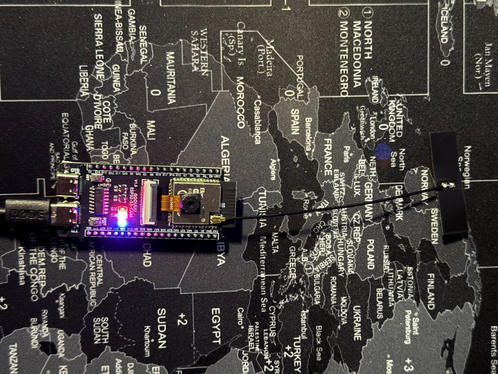

# Guida all'installazione — ESP32-S3-CAM_PDX DATV Beacon

*[English](INSTALL.md)*

Quattro modi per scrivere il firmware sulla scheda, dal più semplice al più completo. I metodi 1–3 **non richiedono
compilatore, Arduino IDE né ESP-IDF**.

| # | Metodo | Serve | Per chi |
|---|---|---|---|
| 1 | **Installazione dal browser** (GitHub Pages) | Chrome o Edge su un computer | tutti |
| 2 | **Pacchetto Windows** (`…_Windows.zip`) | Windows 10/11 | senza internet / utenti Windows |
| 3 | **Python + esptool** | Python 3 | Linux, macOS, script |
| 4 | **Compilazione dai sorgenti** | ESP-IDF 6.1 | sviluppatori |

> **Arduino?** Il firmware è scritto per **ESP-IDF**, l'ambiente ufficiale di Espressif, non per Arduino: comanda la
> radio Wi-Fi a livello di registri, colloca in memoria il modulatore in tempo reale e usa una sua tabella delle
> partizioni. Non si può aprire come sketch Arduino. Per programmare la scheda senza installare nulla usate il metodo
> 1 o 2: il risultato è lo stesso firmware che usa l'autore.



## Prima di iniziare

- Scheda: ESP32-S3 **N16R8** (16 MB flash, 8 MB PSRAM) con camera OV3660. La scheda provata ha due porte USB-C:
  **COM** (convertitore USB-seriale CH340) e **OTG** (USB nativa). Per programmare e per la console usate **COM**.
- Un cavo USB-C **dati** (alcuni cavi caricano soltanto).
- Di fabbrica l'uscita RF di solito è sull'**antenna stampata**, non sul connettore IPEX: leggete
  [ANTENNA_IPEX.md](ANTENNA_IPEX.md#italiano) prima di collegare un filtro o misurare la potenza.
- Windows: Gestione dispositivi → *Porte (COM e LPT)* deve mostrare `USB-SERIAL CH340 (COMx)`. Se non compare,
  installate il driver WCH **CH341SER**.
- Se la programmazione non si collega, entrate a mano in modalità download: tenete premuto **BOOT**, premete e
  rilasciate **RST**, rilasciate **BOOT** e riprovate.

Immagini della release:

| File | Indirizzo | Contenuto |
|---|---|---|
| `…_full.bin` | `0x0` | bootloader, partizioni, firmware, monoscopio standard, sfondo PiP standard. **Cancella impostazioni e monoscopi personalizzati.** |
| `…_app_0x10000.bin` (dalla v1.2.0) | **`0x10000`** | solo firmware. **Conserva** impostazioni e monoscopi personalizzati. |

> **Nota sulle v1.0.0 / v1.1.0:** il loro `…_app_only.bin`, scritto a `0x0`, copre anche l'area delle impostazioni
> (`0x9000`) e quindi **cancella le impostazioni** (i monoscopi personalizzati restano). Dalla v1.2.0 il file di
> aggiornamento contiene solo il firmware e si scrive a `0x10000`.

## 1. Installazione dal browser

1. Aprite **https://photoluis.github.io/Esp32s3-cam-pdx-datv-beacon/** con Chrome o Edge (computer).
2. Collegate la scheda alla porta COM, premete **Installa**, scegliete la porta e confermate.
3. Prima installazione: spuntate *Erase device*. Aggiornamento: lasciatela vuota.
4. Alla fine premete **RST** e passate alla [prima configurazione](#prima-configurazione).

La pagina usa [ESP Web Tools](https://esphome.github.io/esp-web-tools/) e l'interfaccia Web Serial del browser: sul
computer non si installa nulla. Firefox e Safari non supportano Web Serial.

## 2. Pacchetto Windows

1. Scaricate `ESP32-S3-CAM_PDX_DATV_Beacon_v1.2.0_Windows.zip` dalla
   [pagina delle release](https://github.com/Photoluis/Esp32s3-cam-pdx-datv-beacon/releases) ed estraetelo.
2. Doppio clic su:
   - `1_INSTALL_FULL_erase.bat` per la prima installazione;
   - `2_UPDATE_firmware_only.bat` per aggiornare conservando le impostazioni.
3. Scrivete la porta COM (es. `COM3`) oppure premete Invio per il riconoscimento automatico.

Il pacchetto contiene `esptool.exe` di Espressif (GPL-2.0), le due immagini e gli script. La prima volta Windows
SmartScreen può chiedere conferma (*Ulteriori informazioni → Esegui comunque*).

## 3. Python + esptool

```
python -m pip install esptool
# prima installazione (cancella impostazioni e monoscopi personalizzati)
python -m esptool --chip esp32s3 --port COM3 -b 460800 write-flash 0x0 ESP32-S3-CAM_PDX_DATV_Beacon_v1.2.0_full.bin
# solo aggiornamento
python -m esptool --chip esp32s3 --port COM3 -b 460800 write-flash 0x10000 ESP32-S3-CAM_PDX_DATV_Beacon_v1.2.0_app_0x10000.bin
```
Su Linux la porta è `/dev/ttyUSB0` (utente nel gruppo `dialout`); su macOS `/dev/cu.wchusbserial*`.

## 4. Compilazione dai sorgenti (ESP-IDF)

```
cd firmware
idf.py set-target esp32s3
idf.py -p COM3 flash monitor
```
Monoscopio standard e sfondo PiP (Python 3 con numpy e Pillow, ffmpeg con libx265):
```
cd tools
python make_es.py -o out/mono_es.bin
python make_bg.py -o out/bg_std.bin
python -m esptool --port COM3 write-flash 0x810000 out/mono_es.bin 0xC10000 out/bg_std.bin
```

### Seeed XIAO ESP32S3 / XIAO ESP32S3 Plus (senza camera)

La XIAO (ESP32-S3R8, 8 MB di PSRAM octal; la Plus ha 16 MB di flash) fa girare il beacon e il Parrot senza camera:
monoscopio, immagine personalizzata, barre dal vivo e risposta del Parrot funzionano; camera e PiP sono nascosti nella
pagina web. Differenze: console seriale sulla **USB nativa** (niente CH340, `/dev/ttyACM0` su Linux), STOP con il
pulsante **BOOT** (GPIO0), LED di stato = il LED giallo della scheda (GPIO21), distinto dal ritmo: acceso = ricezione,
lampo breve ogni 2 s = attesa, lampeggio 1–5 Hz = TX, lampeggio veloce = nominativo acquisito / attività. Antenna sul
connettore U.FL.
```
cd firmware
idf.py -B build_xiao -D SDKCONFIG=build_xiao/sdkconfig -D SDKCONFIG_DEFAULTS="sdkconfig.defaults;sdkconfig.defaults.xiao" build
idf.py -B build_xiao -p /dev/ttyACM0 flash monitor
```
Monoscopio e sfondi si scrivono come sopra (`--port /dev/ttyACM0`).

## Prima configurazione

1. Dopo **RST** la scheda accende l'access point di configurazione: rete **`NOCALL-BEACON`**, password
   **`beacon13cm`**.
2. Aprite **http://192.168.4.1** (11 lingue).
3. Impostate **il vostro nominativo** (QRZ), il **QTH locator** (es. `JN80PS`, dalla v1.1.0), frequenza, FEC, livello e ciclo,
   poi **Applica e salva**.
4. Cambiate la password del Wi-Fi dal menu (il nome della rete diventa `<NOMINATIVO>-BEACON`).
5. In alternativa dalla console seriale (115200 baud): `SET call IZ7PDX`, `SET loc JN80PS` (dalla v1.1.0), `SAVE`, `CONFIG`.

**Solo per radioamatori con licenza**, sulle frequenze e con le potenze consentite, sempre con un filtro passa-banda
sull'uscita.
