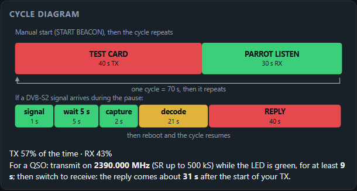
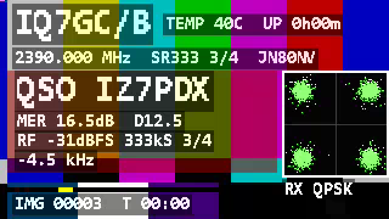
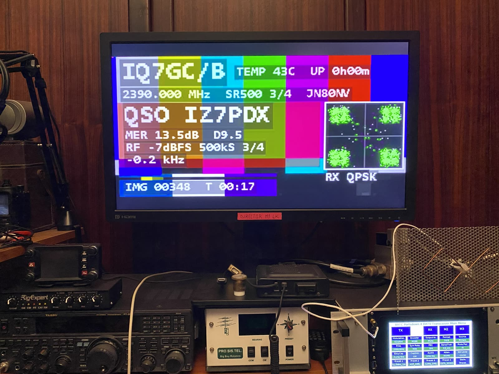

# Parrot mode — user guide (v1.2.0)

*English · [Italiano](PARROT_GUIDE_it.md)*

In **Parrot** mode the beacon also **listens on its own frequency** during the pauses of its cycle. If another
station transmits DVB-S2 there, the beacon receives it, reads its callsign from the DVB service name (SDT), measures the
signal and **answers on the air** with a report: callsign, MER, margin, level, symbol rate, FEC and frequency offset,
plus a small picture of what it received. Everything runs on the ESP32-S3 itself: no PC, no SDR.

**Licence:** a station that answers by itself is an automatic station. Check that your licence allows it.

## 1. Setting it up

Open the web page (Wi-Fi network `<CALLSIGN>-BEACON`, http://192.168.4.1), section **Parrot (automatic reply)**:

| Field | Meaning | Default |
|---|---|---|
| **Parrot on** | listen during the cycle pauses | off |
| **Reply duration (s, 10–250)** | how long the beacon transmits its answer after a QSO | 60 |
| **Wait before capture (s, 0–30)** | when a signal is heard, wait this long before recording it, so the other transmitter can settle (frequency drift right after PTT) | 3 |

In **Beacon cycle** set a **pause of at least 30 s** (35–40 s is more comfortable): the beacon listens only during the
pause. Then press **Apply and save** and **START BEACON**.

The other station must transmit **DVB-S2 QPSK** on the **beacon frequency (±200 kHz)** with a symbol rate **from 40 to
500 kS** (40, 50, 66, 100, 125, 250, 333, 400, 500 kS, e.g. from ESP32-ATV). Any FEC and frame type are accepted. Serial commands: `SET parrot on`, `SET preply 40`, `SET pstab 5`, `SAVE`.

## 2. Tutorial: reading the cycle diagram

The **Cycle diagram** section of the web page redraws itself while you change the fields, even before *Apply*. Example:
test card 40 s, camera 0 s, pause 30 s, reply 40 s, wait 5 s:

- **Top bar = one cycle**, to scale: red = the beacon transmits (TX), green = Parrot listening (RX), yellow = idle
  (pause without Parrot). Here: 40 s TX + 30 s listening = 70 s, then the cycle repeats. Below it, the share of time in
  TX and RX (57% / 43%).
- **Bottom bar = what happens when a DVB-S2 signal arrives during the pause**: the signal is detected (≈1 s), the
  beacon waits *Wait before capture* (5 s), records 2 s, decodes (≈20–25 s, yellow), then **reboots and transmits the
  REPLY** (40 s). After the reply the normal cycle resumes.
- **The sentence at the bottom is the recipe for the other station**: frequency, minimum TX time (wait + about 4 s) and
  when the reply arrives (about wait + 26 s after the start of the transmission).
- If the pause is too short to listen comfortably, a warning appears.

**How to make a QSO** (measured on 06/11/2026 with a Portsdown 4 on 2390 MHz):

1. Wait until the beacon LED is **steady green** (listening).
2. Transmit DVB-S2 on the beacon frequency for **about 15 s**, then **switch to receive** on the same frequency and SR
   of the beacon. The beacon answers on its own frequency: you will not see the reply while you are still transmitting.
3. When the beacon has read your callsign its LED **blinks fast green**; a few seconds later it turns **blinking red**
   and the reply is on the air: about **32 s** after the start of your transmission at 333 kS, about **38 s** at
   500 kS (with *Wait before capture* = 5 s).

## 3. The LED

| LED | Meaning |
|---|---|
| steady **yellow** | standby (idle, configuration, decoding) |
| **red**, blinking | the beacon is transmitting; it blinks faster at higher output level (1 Hz at −40 dB, 5 Hz at −5 dB) |
| steady **green** | receiving: Parrot listening during the pause — **transmit now** |
| **fast green** blinking | Parrot has read a callsign; stays on until the reply starts |
| slow yellow blink, 3 s | settings applied / saved |
| short fast green blink | serial command or web request received |

## 4. The reply

*On the air, 06/11/2026: reply at 500 kS received on a Portsdown 4 (MER 13.5 dB, D 9.5, RF −7 dBFS, constellation of the received signal in the corner).*

- Top: the beacon callsign, temperature/uptime, frequency, SR, FEC and locator.
- Red band (50% transparent): **QSO** and the callsign received, then the report: **MER** and margin **D** (MER minus
  the threshold of that FEC), **RF** level in dBFS (average power of the recording; 0 dBFS = full scale of the
  receiver; fixed gain, so values can be compared between QSOs, but they are not calibrated in dBm), symbol rate, FEC and
  frequency offset. The same report goes into the DVB provider name ("QRK IZ7PDX 20.1dB D16.1").
- The reply uses the **symbol rate of the station received** (125, 250, 333 or 500 kS), so its receiver is already
  tuned.
- Corner box, depending on the video of the station received:

| Station received sends | Corner box |
|---|---|
| H.264 **Baseline** profile | its picture (grey, 128x72) |
| H.264 Main / High profile (e.g. Portsdown 4) | the received **QPSK constellation** |
| H.265 | the received **QPSK constellation** |

The ESP32-S3 has only a Baseline H.264 decoder, so the picture is shown only in the first case. The constellation still
tells a lot: four tight green dots = clean signal, wide clouds = low MER.

## 5. Tutorial: a physical STOP button on GPIO0

The **BOOT** button of the board (next to the TTL connector) is **GPIO0**. It has an internal pull-up; pressing it
connects GPIO0 to **GND**. The firmware reads it as **STOP**: it stops a transmission, a pause or a Parrot listening, and
the board reboots into configuration mode with the access point on (no automatic start).

For a button outside the box (e.g. on the mast enclosure) wire a **normally open** push button **between GPIO0 and
GND**, in parallel with BOOT. No resistor is needed. Keep the wires short or twisted.

**Warning:** if GPIO0 is held at GND **while the board powers up or resets**, the ESP32-S3 enters download
(programming) mode and the beacon does not start. Press the button only when the board is already running, never use a
latching switch, and release it before resetting.

Any character sent on the serial port also stops the transmission.

## 6. Limits and tips

- Detection threshold: about **10 dB** above the noise in the 1 MHz around the beacon frequency; very weak signals are
  ignored (they would also be at the limit of decoding).
- At **500 kS** the MER read by the beacon is a few dB lower than at 333 kS (edge attenuation of the board's receive
  filter); the margin D tells whether the signal was really decodable.
- **Below 100 kS** (40–66 kS) the beacon listens alternately on its frequency and with the LO 80 kHz above it (the
  receiver has a ±25 kHz hump around its LO that would cover a narrow signal) and records 4 s at 500 ksps instead of
  2 s at 1 Msps. Use **short frames** (a normal frame lasts 0.83 s at 40 kS). The reply uses the same symbol rate and
  frame size; below 100 kS it is a still picture at 2 fps without audio (the TS carries only 55–145 kbit/s), with PAT/PMT
  every 0.5 s and PCR every 100 ms. Not yet tested on the air (decoder tested on synthetic 40/50/66 kS captures).
- Very strong signals (RF close to 0 dBFS) can saturate the receiver: move away or reduce power.
- During the pauses with Parrot on, the access point is off; to change settings stop the beacon (BOOT) first.
- Tested on the air on 06/11/2026 with a Portsdown 4 (H.264 High, 1024x576): 333 kS 3/4 MER 18.6–20.1 dB,
  500 kS 3/4 MER 13.5 dB, replies received with the report and the constellation.

## 7. Serial commands

| Command | Use |
|---|---|
| `SET parrot on\|off`, `SET preply <10..250>`, `SET pstab <0..30>` | settings (then `SAVE`) |
| `PARROT <listen_s> <reply_s> [wait_s] [dry]` | one listening session outside the cycle; `dry` = no reply |
| `PARROTPAUSE <s> dry` | test the pause listening without transmitting |
| `PARROTDEC` | decode the last recording again |
| `PARROTDUMP <packets>` | the reply as a TS in hex, without RF (for tests) |
