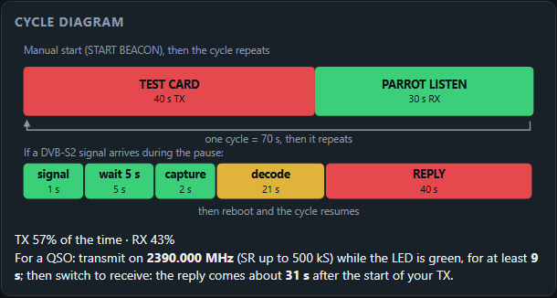
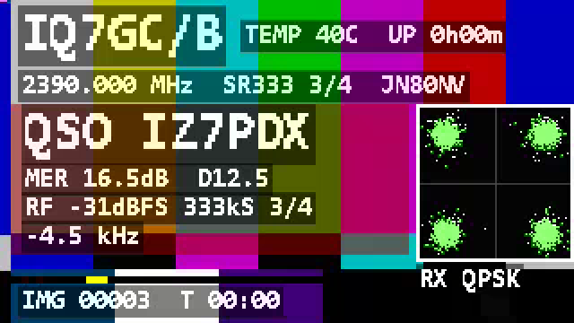
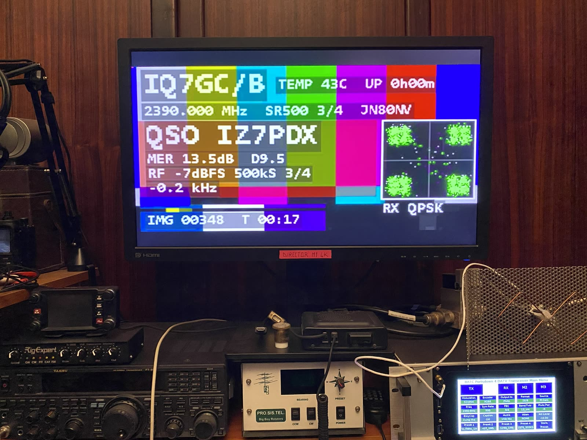

# Modo Parrot — guida (v1.2.0)

*[English](PARROT_GUIDE.md) · Italiano*

Con il modo **Parrot** il beacon, nelle pause del ciclo, **ascolta sulla propria frequenza**. Se un'altra stazione vi
trasmette in DVB-S2, il beacon la riceve, legge il nominativo dal nome del servizio DVB (SDT), misura il segnale e
**risponde in aria** con un rapporto: nominativo, MER, margine, livello, symbol rate, FEC e scarto di frequenza, più un
piccolo riquadro con quello che ha ricevuto. Tutto gira sull'ESP32-S3: niente PC, niente SDR.

**Licenza:** una stazione che risponde da sola è una stazione automatica. Verifica che la tua licenza lo consenta.

## 1. Impostazione

Apri la pagina web (rete Wi-Fi `<QRZ>-BEACON`, http://192.168.4.1), sezione **Parrot (risposta automatica)**:

| Campo | Significato | Predefinito |
|---|---|---|
| **Parrot acceso** | ascolto nelle pause del ciclo | spento |
| **Durata della risposta (s, 10–250)** | quanto trasmette il beacon la risposta dopo un QSO | 60 |
| **Attesa prima della cattura (s, 0–30)** | sentito un segnale, il beacon aspetta questi secondi prima di registrarlo, perché l'altro trasmettitore si stabilizzi (deriva di frequenza subito dopo il PTT) | 3 |

In **Ciclo del beacon** imposta una **pausa di almeno 30 s** (35–40 s è più comodo): il beacon ascolta solo nella
pausa. Poi **Applica e salva** e **AVVIA BEACON**.

L'altra stazione deve trasmettere **DVB-S2 QPSK** sulla **frequenza del beacon (±200 kHz)** con symbol rate **fino a
500 kS**. Qualunque FEC e tipo di frame. Da seriale: `SET parrot on`, `SET preply 40`, `SET pstab 5`, `SAVE`.

## 2. Tutorial: leggere lo schema del ciclo

La sezione **Schema del ciclo** della pagina web si ridisegna mentre modifichi i campi, anche prima di *Applica*.
Esempio: monoscopio 40 s, camera 0 s, pausa 30 s, risposta 40 s, attesa 5 s:

- **Barra in alto = un ciclo**, in scala: rosso = il beacon trasmette (TX), verde = ascolto Parrot (RX), giallo =
  attesa (pausa senza Parrot). Qui: 40 s di TX + 30 s di ascolto = 70 s, poi il ciclo si ripete. Sotto, la quota di
  tempo in TX e in RX (57% / 43%).
- **Barra in basso = cosa succede se nella pausa arriva un DVB-S2**: il segnale viene sentito (≈1 s), il beacon aspetta
  l'*Attesa prima della cattura* (5 s), registra 2 s, decodifica (≈20–25 s, giallo), poi **si riavvia e trasmette la
  RISPOSTA** (40 s). Dopo la risposta il ciclo normale riprende.
- **La frase in fondo è la ricetta per l'altra stazione**: frequenza, durata minima della TX (attesa + circa 4 s) e
  quando arriva la risposta (circa attesa + 26 s dall'inizio della trasmissione).
- Se la pausa è troppo corta per ascoltare con calma compare un avviso.

**Come fare un QSO** (misurato il 06/11/2026 con un Portsdown 4 su 2390 MHz):

1. Aspetta che il LED del beacon sia **verde fisso** (ascolto).
2. Trasmetti in DVB-S2 sulla frequenza del beacon per **circa 15 s**, poi **passa in ricezione** sulla stessa
   frequenza e con l'SR del beacon. Il beacon risponde sulla sua frequenza: finché trasmetti non vedi la risposta.
3. Quando il beacon ha letto il tuo nominativo il LED **lampeggia verde veloce**; qualche secondo dopo diventa **rosso
   lampeggiante** e la risposta è in aria: circa **32 s** dopo l'inizio della tua TX a 333 kS, circa **38 s** a 500 kS
   (con *Attesa prima della cattura* = 5 s).

## 3. Il LED

| LED | Significato |
|---|---|
| **giallo** fisso | standby (attesa, configurazione, decodifica) |
| **rosso** lampeggiante | il beacon trasmette; lampeggia più veloce a livello più alto (1 Hz a −40 dB, 5 Hz a −5 dB) |
| **verde** fisso | ricezione: ascolto Parrot nella pausa — **trasmetti ora** |
| **verde veloce** lampeggiante | il Parrot ha letto un nominativo; resta fino all'inizio della risposta |
| giallo lento per 3 s | impostazioni applicate / salvate |
| breve verde veloce | comando dalla seriale o richiesta web ricevuti |

## 4. La risposta

*In aria, 06/11/2026: risposta a 500 kS ricevuta su un Portsdown 4 (MER 13,5 dB, D 9,5, RF −7 dBFS, costellazione del segnale ricevuto nell'angolo).*

- In alto: nominativo del beacon, temperatura/accensione, frequenza, SR, FEC e locatore.
- Fascia rossa (trasparente al 50%): **QSO** e il nominativo ricevuto, poi il rapporto: **MER** e margine **D** (MER
  meno la soglia di quel FEC), livello **RF** in dBFS (potenza media della registrazione; 0 dBFS = fondo scala del
  ricevitore; guadagno fisso, quindi i valori si confrontano tra un QSO e l'altro, ma non sono tarati in dBm), symbol
  rate, FEC e scarto di frequenza. Lo stesso rapporto va nel nome del fornitore DVB ("QRK IZ7PDX 20.1dB D16.1").
- La risposta usa il **symbol rate della stazione ricevuta** (125, 250, 333 o 500 kS): il suo ricevitore è già
  sintonizzato.
- Riquadro nell'angolo, secondo il video della stazione ricevuta:

| La stazione ricevuta trasmette | Riquadro |
|---|---|
| H.264 profilo **Baseline** | la sua immagine (in grigi, 128x72) |
| H.264 profilo Main / High (es. Portsdown 4) | la **costellazione QPSK** ricevuta |
| H.265 | la **costellazione QPSK** ricevuta |

L'ESP32-S3 ha solo un decodificatore H.264 Baseline, quindi l'immagine compare solo nel primo caso. La costellazione dice
comunque molto: quattro punti verdi stretti = segnale pulito, nuvole larghe = MER basso.

## 5. Tutorial: pulsante fisico di STOP su GPIO0

Il pulsante **BOOT** della scheda (lato connettore TTL) è il **GPIO0**. Ha il pull-up interno; premendolo il GPIO0 va a
**GND**. Il firmware lo legge come **STOP**: ferma una trasmissione, una pausa o un ascolto Parrot, e la scheda si
riavvia in configurazione con l'access point acceso (nessuna partenza automatica).

Per un pulsante esterno (per esempio sulla scatola al traliccio) collega un pulsante **normalmente aperto** **tra GPIO0
e GND**, in parallelo a BOOT. Non serve nessuna resistenza. Fili corti o intrecciati.

**Attenzione:** se il GPIO0 è a GND **mentre la scheda si accende o si resetta**, l'ESP32-S3 entra in modo
programmazione (download) e il beacon non parte. Premi il pulsante solo a scheda già avviata, non usare un interruttore
che resta chiuso, e rilascialo prima di un reset.

Anche un carattere qualsiasi sulla seriale ferma la trasmissione.

## 6. Limiti e consigli

- Soglia di rilevamento: circa **10 dB** sopra il rumore nel MHz attorno alla frequenza del beacon; i segnali molto
  deboli vengono ignorati (sarebbero comunque al limite della decodifica).
- A **500 kS** il MER letto dal beacon è qualche dB più basso che a 333 kS (attenuazione ai bordi del filtro di
  ricezione della scheda); il margine D dice se il segnale era davvero decodificabile.
- Segnali fortissimi (RF vicino a 0 dBFS) possono saturare il ricevitore: allontanati o riduci la potenza.
- Nelle pause con il Parrot acceso l'access point è spento; per cambiare le impostazioni ferma prima il beacon (BOOT).
- Provato in aria il 06/11/2026 con un Portsdown 4 (H.264 High, 1024x576): 333 kS 3/4 MER 18,6–20,1 dB, 500 kS 3/4
  MER 13,5 dB, risposte ricevute con il rapporto e la costellazione.

## 7. Comandi seriali

| Comando | Uso |
|---|---|
| `SET parrot on\|off`, `SET preply <10..250>`, `SET pstab <0..30>` | impostazioni (poi `SAVE`) |
| `PARROT <ascolto_s> <risposta_s> [attesa_s] [dry]` | un ascolto fuori dal ciclo; `dry` = senza risposta |
| `PARROTPAUSE <s> dry` | prova dell'ascolto della pausa senza trasmettere |
| `PARROTDEC` | decodifica di nuovo l'ultima registrazione |
| `PARROTDUMP <pacchetti>` | la risposta come TS in esadecimale, senza RF (per le prove) |
