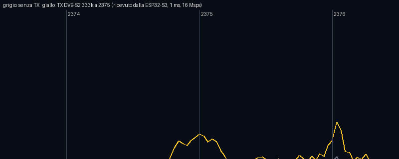
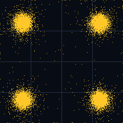
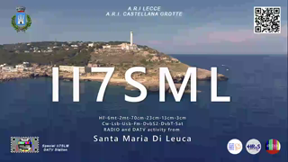

# Modo PARROT — fase P1: ricezione con l'ESP32-S3

*02/11/2026 — IZ7PDX. Scheda GOOUUU ESP32-S3-CAM V1.5 (COM5), antenna stampata (IPEX non collegato). Trasmettitore di
prova dell'operatore: DVB-S2 QPSK 3/4, 333 kS, 2375,000 MHz, potenza minima, a pochi metri.*

## P1a — cattura grezza (1 ms a 16 Msps)

- Motore di cattura della radio dell'S3 (registri e sequenza da esp32-sdr-trx / eSpDR, licenza 0BSD) avviato dentro il
  firmware ESP-IDF del beacon: PLL sintonizzato in software (25 ms), AGC del Wi-Fi spento, banco 0x3FCD0000.
- **Sintonia verificata senza trasmettere** con l'armonica del quarzo a 2400,000 MHz: posizione esatta entro la
  risoluzione di 1 kHz.
- **Lo spettro del motore è invertito**: il segnale vero è I − jQ.
- Disturbi interni: riga a 2368,000 MHz e gruppetto a 2375,8–2376,2 MHz (si spostano con il passo di 30 MHz del PLL),
  fuori dalla banda di un segnale a 333 kS centrato su 2375.
- Segnale DVB-S2 dell'operatore visto nella banda del canale: +7 dB sul rumore nella cattura di 1 ms.

## P1b — cattura continua decimata (2–3 s a 1 Msps)

- Il motore scrive in un banco di SRAM per volta e **la CPU non può leggere il banco che il motore sta scrivendo**
  (legge un valore fisso). Si usano a turno i due banchi riservati 0x3FCC0000 e 0x3FCD0000, ~12288 coppie (0,77 ms) per
  banco; la fine esatta di ogni blocco si trova con segnaposto scritti prima. L'indice dell'anello prosegue da un banco
  all'altro (verificato con `RXSWITCH`).
- Decimatore CIC3 /16 (16 Msps → 1 Msps): su un solo core costava ~14 cicli/coppia su 15 disponibili (troppo al
  limite); ora **il core 0 calcola I e il core 1 calcola Q** sugli stessi blocchi, con le interruzioni sospese su
  entrambi durante la cattura. Continua misurata in 300 µs prima della cattura e sottratta.
- 3 s di cattura: 48 milioni di coppie, **motore mai oltre il lettore**, ritardo massimo 6718 coppie su 16384.
- Trasferimento al PC (`RXDUMP`): blocchi da 4 KB con CRC a 230400 baud, ripetizione dei blocchi rovinati; a 460800
  la CH340 perde byte.

## Prima decodifica di un segnale vero

Cattura di 2 s dalla scheda, decodificata sul PC con `tools/parrot/s2_rx.py` (SR indicato: 333 kS):

| Voce | Valore |
|---|---|
| QRZ (SDT) | **IZ7PDX** (fornitore "FIRM2101RC") |
| MODCOD | QPSK 3/4, frame normali, **senza pilot** |
| MER | **16,9 dB** (margine D 12,9) |
| Symbol rate misurato | 332 999 S/s |
| Scarto di frequenza | −4,5 kHz (circa 2 ppm fra i due quarzi) |
| TS | 504 pacchetti con CRC buono su 505, video H.264 |
| Immagine chiave per il PiP | estratta: monoscopio II7SML |

 

## Problemi aperti per la P2

1. **Stima del symbol rate** sul segnale vero: −3 dB misurati a 289 kHz invece di ~333 (calo del CIC ai bordi, segnale
   reale): la stima non viene arrotondata a 333 kS. Correggere la compensazione e la tolleranza (o provare gli SR
   standard e tenere quello che aggancia).
2. **LDPC che non converge** (3 frame su 20) pur con MER 17 e quasi tutti i pacchetti buoni: probabile errore di fase o
   di temporizzazione verso la fine dei frame senza pilot (i bit di parità sono in fondo al frame).
3. **Livello d'uscita basso** (rms ~3,7 conteggi) e continua residua: shift 9 invece di 11, controllo della
   sottrazione della continua; il guadagno forzato del ricevitore non ha ancora effetto.
4. Rilevatore: con il solo rumore reale (spettro non piatto) segnala un segnale inesistente; serve una soglia sul
   PLHEADER, non solo sullo spettro.
5. Tutto questo va poi portato sull'S3 (P2): demodulatore e LDPC in C, senza PC.

## P2 — ricevitore in C sull'ESP32-S3 (03/11/2026)

`firmware/main/s2rx.c` (comandi `RXLOAD` per caricare una cattura dal PC e `RXDEC` per decodificarla, o decodificare
quella appena fatta con `RXSTREAM`). Sulla cattura vera di 2 s, decodificata **sulla scheda**:

| Voce | Python (PC) | ESP32-S3 |
|---|---|---|
| QRZ | IZ7PDX | **IZ7PDX** |
| MER | 16,9 dB | 16,5 dB |
| Frame LDPC buoni | 16/20 | 16/20 |
| BBHEADER buoni | 19 | 18 |
| Pacchetti TS (CRC errati) | 609 (0) | 576 (3) |
| Tempo | — | **20,8 s** (front-end 8,5 s, aggancio 0,9 s, 20 frame 11,4 s) |

Ottimizzazioni (da 42 s per 1 s di segnale a 12 s): FIR in virgola fissa a 25 coefficienti con mescolatore a tabella,
stima di temporizzazione su un blocco ogni due, metrica dei PLHEADER con una sola radice, niente prove dell'SR se la
larghezza è entro il 10% di un valore standard, sindrome LDPC su bitset, LDPC fermato dopo 3 iterazioni senza
miglioramenti (massimo 10), fase con fasori incrementali, niente `double` nei cicli (sull'S3 sono emulati).

Lezioni: (1) la RAM statica del firmware non deve superare 0x3FCC0000 (area riservata alla radio): le tabelle grandi
vanno in PSRAM; (2) la memoria del ricevitore va liberata a ogni decodifica; (3) buffer di cattura 3920 KB (2,0 s).
