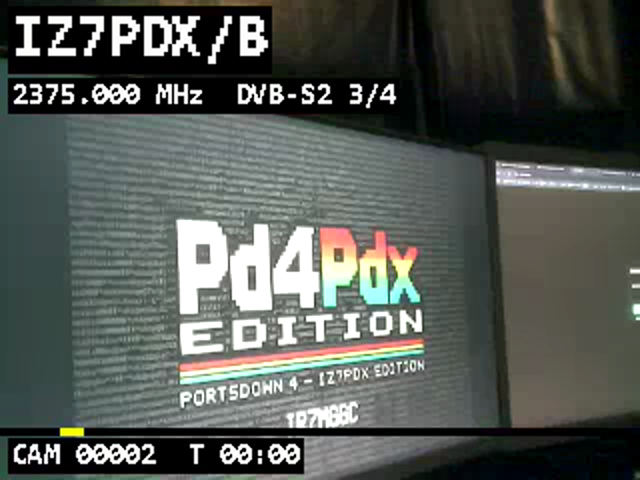
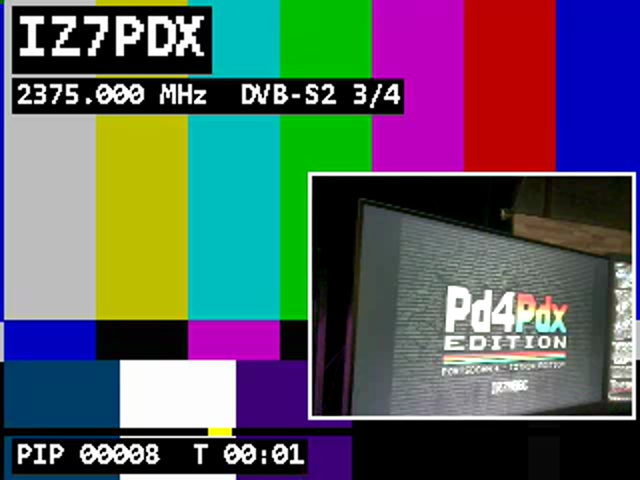
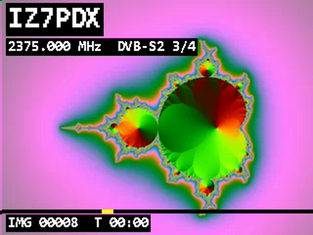
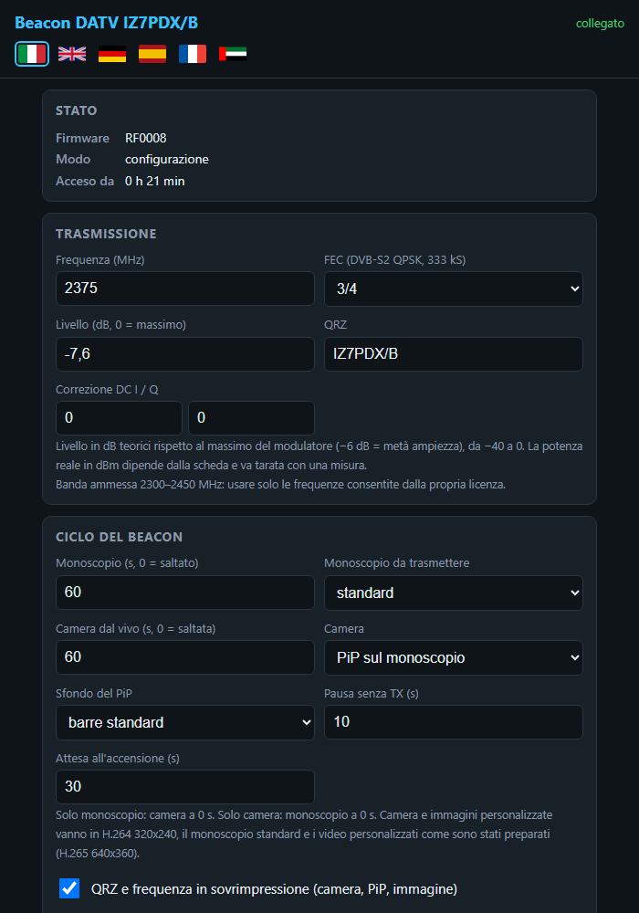

# Beacon DATV 13 cm su ESP32-S3 — il progetto

**Luigi D'Arcangelo, IZ7PDX** — ottobre 2026 — licenza GPL-3.0

Un beacon di televisione digitale amatoriale **DVB-S2** per la banda dei **13 cm (2300–2450 MHz)** realizzato con una sola
scheda ESP32-S3 con camera, che costa poche decine di euro. La scheda codifica il video, costruisce il flusso MPEG-TS,
calcola la codifica DVB-S2 secondo la norma ETSI e genera il segnale QPSK in radiofrequenza con il proprio trasmettitore
Wi-Fi, usato come modulatore I/Q. Non servono SDR, PC né Raspberry: basta alimentarla e collegare un'antenna (e, per l'uso
in aria, un filtro e se serve un amplificatore).


## In sintesi

| | |
|---|---|
| Standard | DVB-S2 (ETSI EN 302 307-1 V1.4.1), QPSK, frame normali o corti, pilot, FEC da 1/2 a 9/10 |
| Symbol rate collaudato | **333 kS/s** (banda occupata circa 450 kHz) |
| Frequenza | 2300–2450 MHz, impostabile al kHz (standard del beacon: **2375,000 MHz**) |
| Video | monoscopio H.265 640x360 25 fps precodificato; **camera dal vivo H.264 320x240** (5–7 fps, 9 fps in PiP) |
| Audio | AAC mono 32 kbit/s (tono di identificazione da 1 kHz) |
| Modi | monoscopio standard, video o immagine personalizzati, camera a pieno schermo, camera in **PiP** sul monoscopio |
| Controllo | pagina web dal telefono (access point a TX ferma) in 6 lingue, seriale, partenza automatica all'accensione |
| Qualità in ricezione | **MER 23–27 dB** con Portsdown 4 + Minitiouner (prove indoor a 4 m) |
| Hardware | ESP32-S3 N16R8 con camera OV3660 (diymore ESP32-S3-CAM, disposizione Freenove) |

## Perché l'ESP32-S3 con camera

La scelta della scheda è il cuore del progetto: ogni funzione del beacon trova posto in un componente che già c'è.

- **Il trasmettitore è già a bordo.** La radio Wi-Fi a 2,4 GHz dell'ESP32-S3 ha un oscillatore locale che si sintonizza
  anche fuori dai canali Wi-Fi, dentro la banda radioamatoriale dei 13 cm, e un convertitore digitale-analogico I/Q che il
  firmware può pilotare direttamente. La parte RF più difficile di un trasmettitore DATV è quindi già sulla scheda.
- **Due core a 240 MHz.** Uno genera i campioni del segnale con tempi al ciclo di clock, l'altro calcola tutto il resto:
  video, multiplexer, codifica DVB-S2: una separazione dei compiti rara a questo prezzo.
- **8 MB di PSRAM e 16 MB di flash** (versione N16R8): spazio per le immagini della camera, i buffer dell'encoder e,
  in flash, il monoscopio, un video personalizzato fino a 3 MB e le immagini.
- **La camera è sulla stessa scheda.** Il modulo OV3660 (3 MP) collegato al bus camera del chip fornisce immagini YUV
  che l'encoder H.264 software di Espressif comprime direttamente sull'ESP.
- **Wi-Fi anche per configurare.** Quando non trasmette, la stessa radio diventa un access point con la pagina di
  configurazione: dal telefono si cambiano frequenza, modi e immagini senza cavi.
- **Costo, consumo, dimensioni.** Una scheda da poche decine di euro, alimentata da USB, piccola abbastanza da stare in un
  contenitore stagno sul traliccio insieme a filtro e amplificatore.

La scheda usata è la **diymore ESP32-S3-CAM N16R8** (modulo ESP32-S3-WROOM-1 N16R8, camera OV3660, slot microSD, USB-C
nativa e porta seriale TTL con CH340, connettore IPEX per l'antenna esterna), con la stessa disposizione dei pin della
**Freenove ESP32-S3-WROOM CAM**: il firmware funziona con entrambe e, cambiando pochi pin, con le schede ESP32-S3 con camera
più diffuse.

## A chi serve: il mondo radioamatoriale

- **Beacon di propagazione e di riferimento sui 13 cm.** Un segnale DVB-S2 continuo e identificato (QRZ in video e nel
  nome del servizio) permette di verificare antenne, preamplificatori, ricevitori e percorsi radio: la MER letta dal
  ricevitore è una misura immediata della qualità del collegamento.
- **Ingresso alla DATV a costo minimo.** Chi ha un ricevitore come il Minitiouner o il Portsdown può avere un trasmettitore
  completo, con camera, al prezzo di una scheda di sviluppo.
- **Didattica e sperimentazione.** Il codice mostra passo per passo una catena DVB-S2 completa — dal pacchetto TS al
  simbolo QPSK — scritta da zero e verificata bit per bit: un riferimento per corsi, sezioni ARI e gruppi DATV.
- **Ponti e reti ATV.** Un trasmettitore autonomo, configurabile da telefono e con partenza automatica, è adatto come
  sorgente di prova o di identificazione per ponti DATV e postazioni remote.
- **Eventi e attività in portatile.** Camera dal vivo e immagine personalizzata (logo di un contest, di una sezione, di
  un'attivazione) si cambiano dal telefono sul posto.
- **Base per altri progetti.** Il codificatore DVB-S2 e il multiplexer TS sono moduli separati, riutilizzabili su altre
  piattaforme e con altri front-end RF (amplificatori, transverter).

## Come funziona

```
 CORE 1 (calcolo)
   camera OV3660 ─► PiP + sovrimpressione ─► encoder H.264 ──┐
   monoscopio H.265 / video personalizzato (flash) ──────────┤
   tono AAC (flash) ─────────────────────────────────────────┤
                                                             ▼
   multiplexer MPEG-TS (PAT, PMT, SDT, PCR, PES con PTS, bitrate costante)
                                                             ▼
   DVB-S2: BBFRAME + CRC-8 ─► scrambling ─► BCH ─► LDPC ─► QPSK
           ─► PLHEADER, pilot, scrambling PL
                                                             ▼
   buffer circolare di simboli (circa 0,4 s)
                                                             ▼
 CORE 0 (tempo reale, interrupt disattivati)
   filtro RRC 0,35, 6 campioni/simbolo ─► DAC I/Q del Wi-Fi ─► mixer ─► PA ─► IPEX
```

- **Modulatore.** Il core 0 calcola i campioni del segnale QPSK filtrato RRC (roll-off 0,35, 6 campioni per simbolo, circa
  2 MS/s) con una tabella precalcolata, e li scrive nel DAC del Wi-Fi con scadenze contate al ciclo di clock. Durante la
  trasmissione gli interrupt del core 0 sono disattivati: nessun ritardo esterno disturba il segnale.
- **Codificatore DVB-S2.** Scritto da zero dalla norma: intestazione BBHEADER con CRC-8, scrambling del banda base,
  codice BCH, codice LDPC con le tabelle della norma, mappatura QPSK, PLHEADER in π/2-BPSK, pilot e scrambling di livello
  fisico con sequenze di Gold. Un PLFRAME (QPSK 3/4, frame normale con pilot) si calcola in circa 9 ms.
- **Multiplexer TS.** Un programma con video, audio e PCR su PID separati, tabelle PAT/PMT/SDT, timestamp sempre
  crescenti e bitrate costante pari a quello del MODCOD (pacchetti nulli di riempimento).
- **Video.** Il monoscopio è preparato sul PC (H.265 640x360, 25 fps, con barre, QRZ, frequenza e una fascia di controllo
  per vedere eventuali fotogrammi persi) e ripetuto in loop senza discontinuità. La camera e le immagini personalizzate
  sono codificate dal vivo in H.264 320x240 con la sovrimpressione disegnata dall'ESP.
- **Beacon autonomo.** Configurazione in memoria non volatile, partenza automatica con attesa annullabile, ciclo
  monoscopio / camera / pausa. Al cambio di segmento il flusso resta continuo per il ricevitore, che passa da un
  programma all'altro da solo.

## Le tappe dello sviluppo

### 1. Dalla norma ETSI al codificatore di riferimento

Il punto di partenza è la norma **ETSI EN 302 307-1 V1.4.1** (DVB-S2),
<https://www.etsi.org/deliver/etsi_en/302300_302399/30230701/01.04.01_60/en_30230701v010401p.pdf>. Dal PDF sono state
estratte automaticamente le tabelle dei codici LDPC (indirizzi dei bit di parità per tutti i rate, frame normali e corti)
e i parametri dei codici BCH. Su queste basi è stato scritto in Python un **codificatore DVB-S2 di riferimento** completo
(`tools/dvbs2/`): adattamento di modo e di flusso, BCH, LDPC, mappatura, framing di livello fisico, pilot e scrambling.
Il codificatore prepara anche file di simboli già pronti da trasmettere.

### 2. Il trasmettitore dentro il Wi-Fi

L'idea di usare il trasmettitore Wi-Fi di un ESP32 come modulatore I/Q per la DATV è stata dimostrata dal progetto
ESP32-DATV-SA di **SP8ESA**, a cui va il riconoscimento dell'intuizione. Il firmware di questo progetto è scritto in modo
indipendente: dall'analisi delle funzioni di prova RF di Espressif sono stati individuati i registri che permettono di
tenere acceso il trasmettitore, sintonizzarlo e scrivere direttamente nel suo DAC I/Q. In sequenza:

- **portante e tono** con il quarzo della scheda (scarto di circa 1 ppm), verificati con lo SPECTRUM HD del Pd4Pdx;
- **QPSK con filtro RRC 0,35** a 333 kS/s, banda occupata di circa 450 kHz;
- **prima ricezione DVB-S2**: il Portsdown 4 aggancia il segnale con **MER 24,6 dB** e mostra il monoscopio H.265 con il
  suo audio, trasmesso da un file di simboli calcolato sul PC.

La stabilità dei tempi del modulatore ha richiesto alcune messe a punto (cicli critici eseguiti dalla RAM interna e mai
dalla cache della flash, orologio dei campioni continuo, controllo dello stop solo sui registri): da allora il
modulatore scrive centinaia di milioni di campioni con al massimo pochi campioni in ritardo e nessuna interruzione.

### 3. Il beacon autonomo e la pagina web

- **Fase A:** configurazione salvata in memoria non volatile, comandi sulla seriale, partenza automatica all'accensione
  con un'attesa che si annulla con un tasto o con il pulsante BOOT, ciclo del beacon.
- **Fase B:** a trasmissione ferma la radio Wi-Fi diventa un access point (`<QRZ>-BEACON`, http://192.168.4.1) con la
  pagina di configurazione, collaudata dal telefono; prima di ogni trasmissione la scheda riparte con la radio nello stato
  del modulatore. Frequenza standard del beacon: **2375,000 MHz**, nel segmento DATV dei 13 cm e lontano dalle armoniche
  dei clock della scheda.

### 4. DVB-S2 e TS calcolati sull'ESP

- **Fase C1:** il codificatore DVB-S2 è stato portato in C sull'ESP32-S3, con le tabelle generate dal codificatore Python.
  Un test automatico confronta l'uscita dell'ESP con quella del PC: **42 casi su 42 identici bit per bit** (tutti i rate,
  frame normali e corti, con e senza pilot).
- **Fase C2:** il multiplexer MPEG-TS gira sull'ESP e il monoscopio è memorizzato come flussi elementari H.265 e AAC,
  ripetuti in loop con timestamp sempre crescenti. Collaudo in aria: **due prove da 120 s senza alcuna interruzione,
  MER 25–26 dB, tono continuo, giro del loop invisibile** (verificato con la fascia a scanner e il contatore dei
  fotogrammi del monoscopio).

### 5. La camera, il PiP e i monoscopi personalizzati

- **Fase C3:** la camera OV3660 entra nel flusso: immagini YUV 320x240, sovrimpressione con QRZ, frequenza, contatore e
  barra di controllo disegnate dall'ESP con un font generato sul PC, codifica H.264 software e multiplexer alimentato dalla
  coda dei fotogrammi. In aria: **MER 24–25 dB, video fluido, 0 fotogrammi persi** in prove da 60 e 120 s.
- **Modi selezionabili:** solo monoscopio, solo camera, camera in **Picture-in-Picture** sul monoscopio (a 9 fps), con
  sfondo standard o personalizzato. Il ciclo monoscopio ↔ PiP cambia programma sul ricevitore in modo automatico.
- **Monoscopi personalizzati:** un'**immagine** si carica dal telefono (la pagina la ritaglia e la converte nel browser)
  o dal PC; un **video** si prepara sul PC con `tools/make_es.py` e si carica dalla pagina o dalla porta seriale. Il
  monoscopio standard e lo sfondo standard sono protetti: il firmware non permette di sovrascriverli. In aria l'immagine
  caricata da un iPhone è stata ricevuta con **MER 24+ dB**.
- **Livello di uscita in dB** (0 dB = massimo del modulatore), FEC selezionabile dal menu, pagina web in **italiano,
  inglese, tedesco, spagnolo, francese e arabo**.

### 6. La prova di linearità

Con dieci livelli da −23,5 a 0 dB (dettagli in `docs/TEST_MER_20261030.md`) il trasmettitore risulta **lineare fino a
circa −6 dB**, con MER tra 23 e 26 dB; sopra −3,5 dB l'amplificatore interno del chip entra in compressione (MER intorno
a 17 dB, spalle nello spettro). Il livello predefinito del beacon è −7,6 dB.

| Livello | −23,5 | −17,5 | −13,6 | −11,7 | −9,6 | −7,6 | −5,7 | −3,5 | −1,6 | 0 |
|---|---|---|---|---|---|---|---|---|---|---|
| MER (dB) | 0 | 20,3 | 23,1 | 23,2 | **26,0** | 23,4 | 23,6 | 22,2 | 16,7 | 17,9 |

## Risultati principali

| Prova | Risultato |
|---|---|
| Codificatore DVB-S2 sull'ESP contro il riferimento | 42/42 casi identici bit per bit |
| Monoscopio H.265 + AAC dal multiplexer dell'ESP | MER 25–27 dB, nessuna interruzione in 120 s |
| Camera H.264 320x240 dal vivo | MER 24–25 dB, 5,3–6,7 fps, 0 fotogrammi persi |
| Camera in PiP sul monoscopio | 9 fps, 0 fotogrammi persi, cambio programma automatico |
| Immagine personalizzata caricata da iPhone | MER 24+ dB |
| Linearità | lineare fino a circa −6 dB, compressione sopra −3,5 dB |
| Tempo di codifica di un PLFRAME (QPSK 3/4) | circa 9 ms (il frame dura circa 100 ms) |

## Immagini

| Camera dal vivo | Camera in PiP | Immagine personalizzata |
|---|---|---|
|  |  |  |

Fotogrammi estratti dal flusso TS generato dall'ESP, con la sovrimpressione disegnata dal firmware.



## Struttura del repository

```
firmware/          firmware ESP-IDF 6.1
  main/            modulatore (rf_s3), DVB-S2 (dvbs2_enc), multiplexer (ts_mux),
                   catena dal vivo (live_tx), camera e encoder (cam_live), sovrimpressione,
                   beacon e configurazione, pagina web, aree in flash (media_store)
tools/             strumenti per il PC (Python + ffmpeg)
  dvbs2/           codificatore DVB-S2 di riferimento e tabelle dalla norma
  make_es.py       monoscopio e video personalizzati (flussi elementari H.265 + AAC)
  make_bg.py       immagini 320x240 per PiP e monoscopio fisso
  upload_media.py  caricamento dalla porta seriale
docs/              documentazione, prove, immagini
```

## Riconoscimenti e licenze

- **ETSI EN 302 307-1 V1.4.1** — la norma DVB-S2 è solo citata e non è inclusa nel repository.
- **SP8ESA, ESP32-DATV-SA** — per la dimostrazione che il trasmettitore Wi-Fi dell'ESP32 può fare da modulatore DATV.
  Nessuna parte del suo codice è inclusa in questo progetto.
- **Espressif** — ESP-IDF, esp32-camera ed esp_h264 (licenza Apache 2.0; esp_h264 contiene OpenH264, licenza BSD).
- **BATC** — Portsdown 4 e Minitiouner, usati per tutte le prove di ricezione (Pd4Pdx Edition di IZ7PDX).
- **FFmpeg / x265** — usati sul PC per preparare monoscopi e video.
- Questo progetto: **GPL-3.0**, © 2026 Luigi D'Arcangelo IZ7PDX.

## Avvertenze

Il firmware trasmette solo tra 2300 e 2450 MHz. Va usato **solo da radioamatori con licenza valida**, sulle frequenze e
con le potenze consentite dalla propria licenza e dal band plan. Il DAC del Wi-Fi genera immagini e spurie: per l'uso in
aria è indispensabile un **filtro passa-banda** sull'uscita, e con un amplificatore esterno va scelto un livello di
pilotaggio che lo mantenga nella zona lineare.
