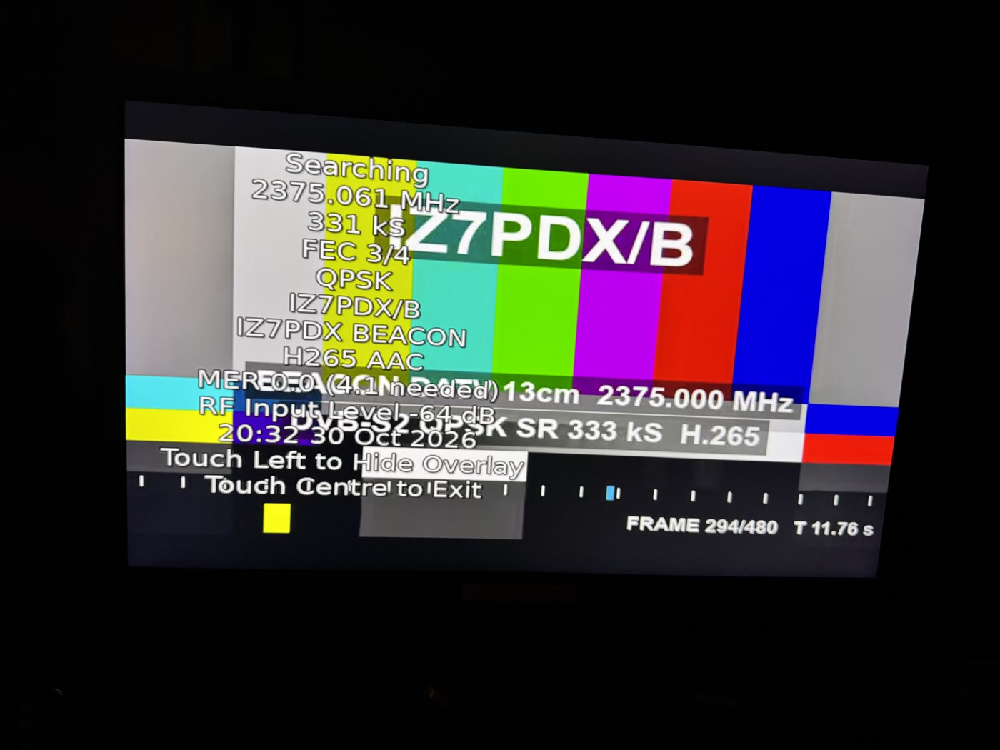
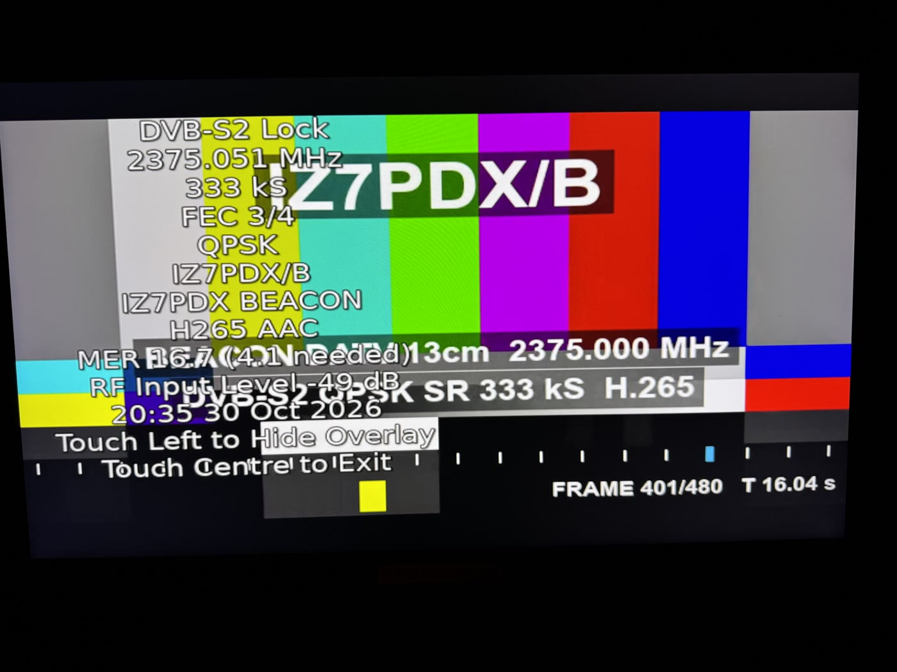
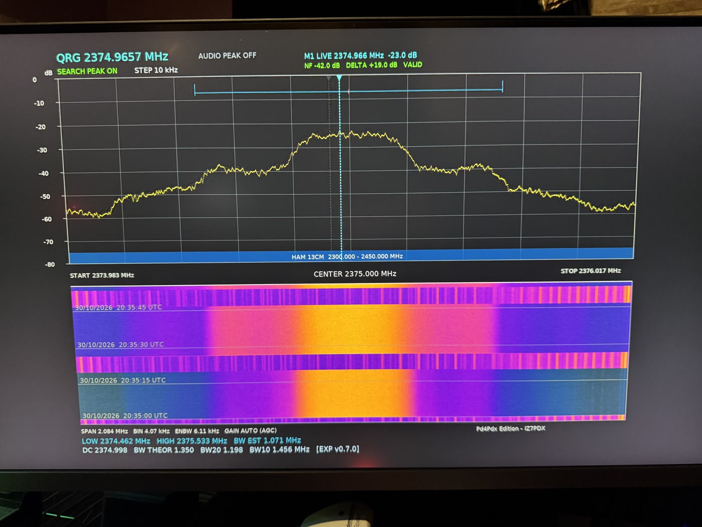

# Prova di linearità: MER in funzione del livello di uscita (30/10/2026)

## Condizioni

| | |
|---|---|
| Trasmettitore | ESP32-S3 N16R8 (diymore ESP32-S3-CAM), firmware RF0008, modulatore I/Q dal DAC del Wi-Fi, **nessun amplificatore né filtro esterno** |
| Antenna TX | dipolo sul connettore IPEX della scheda |
| Segnale | DVB-S2 QPSK 3/4, frame normali con pilot, **333 kS**, 2375,000 MHz, monoscopio standard H.265 + AAC (TS generato sull'ESP) |
| Ricevitore | Portsdown 4 Pd4Pdx + Minitiouner, antenna **Yagi 16 elementi** puntata sul TX, distanza **circa 4 m** |
| Ambiente | interno, con QRM locale |
| Sequenza | 20 s per livello, dal più basso al più alto (`ESPLAY 2375.000 <livello>dB 20`) |

Il livello è in **dB teorici** rispetto al massimo del modulatore (ampiezza digitale 480 = 0 dB; −6 dB = metà ampiezza).
Non è ancora una potenza in dBm: la taratura sul connettore si farà con lo strumento.

## Risultati

| Livello TX (dB teorici) | Ampiezza | MER (dB) | Livello RX Minitiouner (dB) | Frequenza letta dal RX (MHz) | Foto |
|---:|---:|---:|---:|---:|---|
| −23,5 | 32 | **0,0** (nessun aggancio, "Searching") | −64 | 2375,061 | [IMG_8008](img/test_mer_20261030/01_m23.5dB_MER0.0.jpg) |
| −17,5 | 64 | 20,3 | −57 | 2375,056 | [IMG_8010](img/test_mer_20261030/02_m17.5dB_MER20.3.jpg) |
| −13,6 | 100 | 23,1 | −55 | 2375,055 | [IMG_8011](img/test_mer_20261030/03_m13.6dB_MER23.1.jpg) |
| −11,7 | 125 | 23,2 | −54 | 2375,054 | [IMG_8012](img/test_mer_20261030/04_m11.7dB_MER23.2.jpg) |
| −9,6 | 159 | **26,0** | −51 | 2375,053 | [IMG_8013](img/test_mer_20261030/05_m9.6dB_MER26.0.jpg) |
| −7,6 | 200 | 23,4 | −50 | 2375,053 | [IMG_8014](img/test_mer_20261030/06_m7.6dB_MER23.4.jpg) |
| −5,7 | 249 | 23,6 | −48 | 2375,052 | [IMG_8015](img/test_mer_20261030/07_m5.7dB_MER23.6.jpg) |
| −3,5 | 321 | 22,2 | **−47** (massimo) | 2375,052 | [IMG_8016](img/test_mer_20261030/08_m3.5dB_MER22.2.jpg) |
| −1,6 | 399 | **16,7** | −49 | 2375,051 | [IMG_8018](img/test_mer_20261030/09_m1.6dB_MER16.7.jpg), spettro IMG_8019 (sotto) |
| 0 | 480 | **17,9** | −49 | 2375,051 | [IMG_8020](img/test_mer_20261030/10_0dB_MER17.9.jpg) |

Lato ESP, in tutti i passi: buffer dei simboli mai vuoto, nessun PES in ritardo, 2–8 campioni in ritardo su 40 milioni.
La modulazione digitale è identica a ogni livello: le differenze vengono dalla parte analogica.

## Foto

| −23,5 dB: nessun aggancio | −9,6 dB: MER 26,0 | −1,6 dB: MER 16,7 |
|---|---|---|
|  |  |  |

Spettro a −1,6 dB (SPECTRUM HD del Pd4Pdx, span 2 MHz): spalle da compressione a circa 17 dB sotto il canale.

## Osservazioni

- **Zona lineare fino a circa −5,7 dB.** Da −17,5 a −3,5 dB il livello ricevuto sale con il livello impostato (−57 → −47 dB):
  circa 10 dB in RX per 14 dB in TX. La compressione comincia già prima di −3,5 dB.
- **Saturazione sopra −3,5 dB.** A −1,6 e 0 dB il livello ricevuto **scende** (−49 dB) e la MER cala a 16,7–17,9 dB:
  l'amplificatore interno del chip è in compressione. Il video resta comunque perfetto (servono 4,1 dB con QPSK 3/4).
- **Ricrescita spettrale a −1,6 dB** (IMG_8019, SPECTRUM HD del Pd4Pdx, span 2 MHz): spalle a circa 17 dB sotto il canale
  e ben fuori dalla banda occupata (BW stimata 1,07 MHz contro 0,45 MHz teorici a 333 kS). Ai livelli alti il ricevitore
  vicino può contribuire alla saturazione: andrà ricontrollato con un'attenuazione nota.
- **MER massima 23–26 dB** da −13,6 a −5,7 dB, con QRM locale e cammino interno di 4 m: è il limite dell'ambiente di prova
  più che del trasmettitore.
- **Frequenza:** il Minitiouner legge 2375,051–2375,061 MHz (+51…+61 kHz). Lo SPECTRUM HD del Pd4Pdx misura il centro a
  2374,998 MHz, quindi lo scarto viene dal riferimento del ricevitore. Lo scarto cala di 10 kHz durante la prova
  (il ricevitore si scalda).

## Indicazioni

| Uso | Livello |
|---|---|
| massimo consigliato senza amplificatore (MER ≥ 23 dB, spettro pulito) | **−6 dB** |
| predefinito del beacon | −7,6 dB (ampiezza 200) |
| pilotaggio di un amplificatore esterno | da scegliere con la misura dell'amplificatore: a valle di un PA serve un margine di linearità maggiore |
| da evitare | sopra −3,5 dB (compressione, MER in calo, spalle dello spettro) |

Prossimo passo: misura della potenza nel canale (dBm) sul connettore IPEX agli stessi livelli, poi la stessa prova con
filtri e amplificatore della versione per il traliccio.
