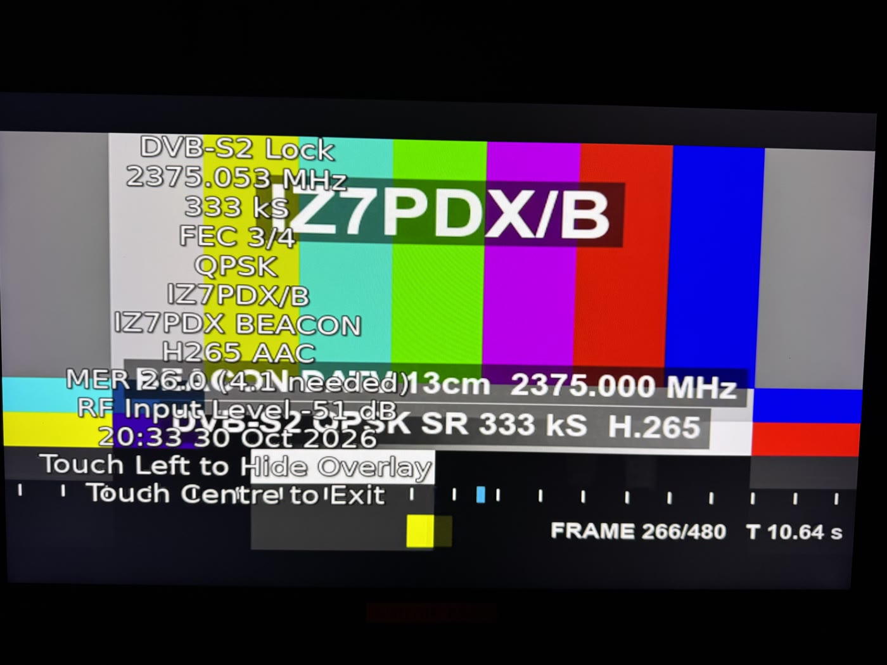

# ESP32-S3-CAM_PDX DATV Beacon

**Un transmisor DVB-S2 completo, con cámara, en una placa de unas pocas decenas de euros**

*Luigi D'Arcangelo, IZ7PDX — proyecto de código abierto, licencia GPL-3.0*

Una sola **placa ESP32-S3 con cámara** se convierte en una baliza de televisión digital de aficionados. El transmisor
Wi-Fi del chip se usa como **modulador I/Q**; todo lo demás — vídeo, multiplexor MPEG-TS, codificación **DVB-S2** según
ETSI EN 302 307-1 y modulación QPSK — lo calcula la propia placa. Sin SDR, PC ni Raspberry Pi: alimentación, antena y
filtro.

## Qué hace

- **DVB-S2 QPSK** a 333 kS/s, FEC de 1/2 a 9/10: recibido con **MER 23–27 dB** en Portsdown 4 y Minitiouner.
- **2300–2450 MHz** directamente; cualquier otra banda con un **mezclador externo**: la frecuencia final aparece en la
  imagen y en el nombre del servicio.
- **Cámara en directo** (H.264), cámara en **imagen dentro de imagen** sobre la carta de ajuste, carta estándar H.265 y
  **cartas personalizadas**: una foto desde el móvil o un vídeo preparado en el PC (¡también hay una de Halloween!).
- **Baliza autónoma**: ciclo carta / cámara / pausa, arranque automático al encender y un **LED de estado** que se
  "calienta" con la potencia.
- **Configuración desde el móvil** en 11 idiomas, sin transmitir.
- Firmware, herramientas, documentación e informes de pruebas **libres** (GPL-3.0).

## Qué se necesita

- Una placa ESP32-S3 N16R8 con cámara (probada: diymore ESP32-S3-CAM, disposición Freenove).
- Una antena para 13 cm y un **filtro paso banda**; un amplificador lineal para distancias mayores.
- Un receptor DVB-S2 (Minitiouner, Portsdown, receptores de satélite compatibles).

## ¡Colaboremos!

El proyecto acaba de nacer y crecerá con la comunidad radioaficionada. Toda contribución es bienvenida:

- **pruebas en el aire**: distancia, MER, receptor y antenas usados, fotos de la recepción;
- **avisos de problemas** y **peticiones de mejora**;
- ideas y montajes: amplificadores y filtros, transverters para otras bandas, otras placas ESP32-S3, velocidades de
  símbolo más altas;
- **revisión de las traducciones** de la página web y de los documentos.

Repositorio, avisos y debates: **https://github.com/Photoluis/esp32s3-cam-pdx-datv-beacon** — contacto: **iz7pdx@gmail.com**

*Aviso: solo para radioaficionados con licencia válida, en las frecuencias y con las potencias que permita su licencia,
siempre con un filtro adecuado en la salida.*
